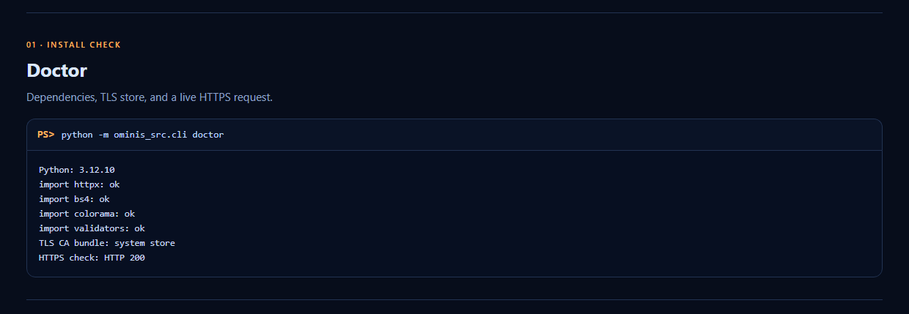
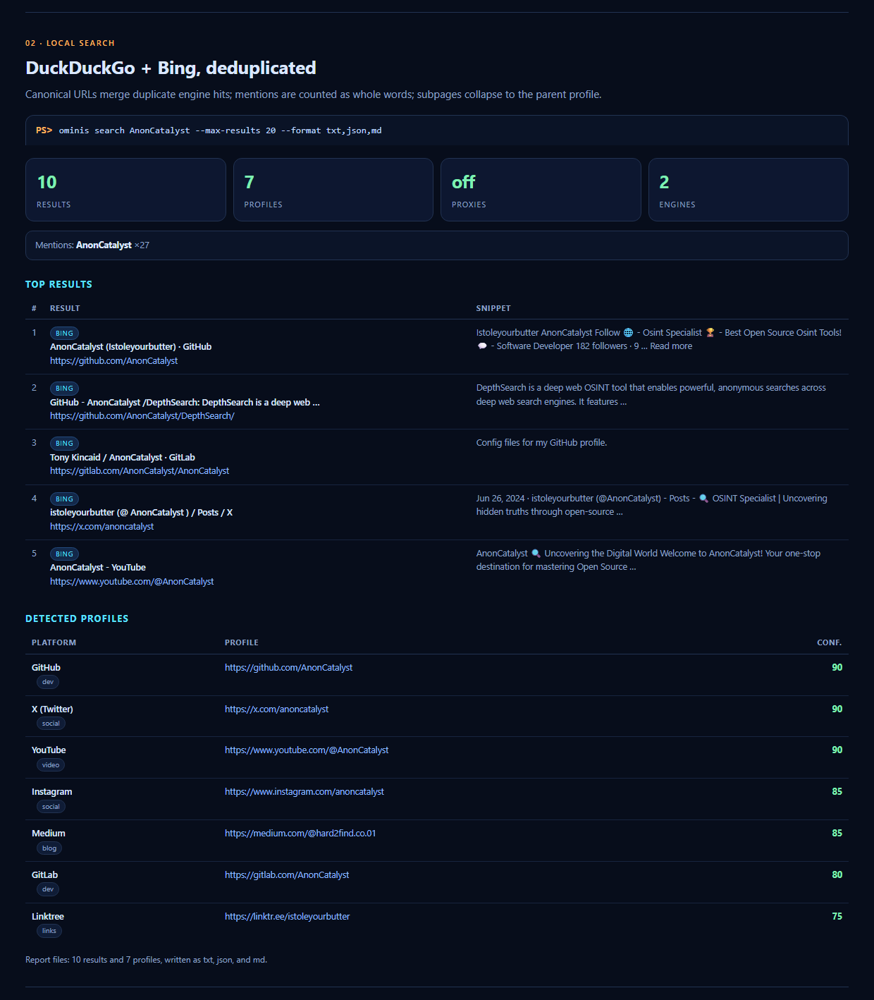
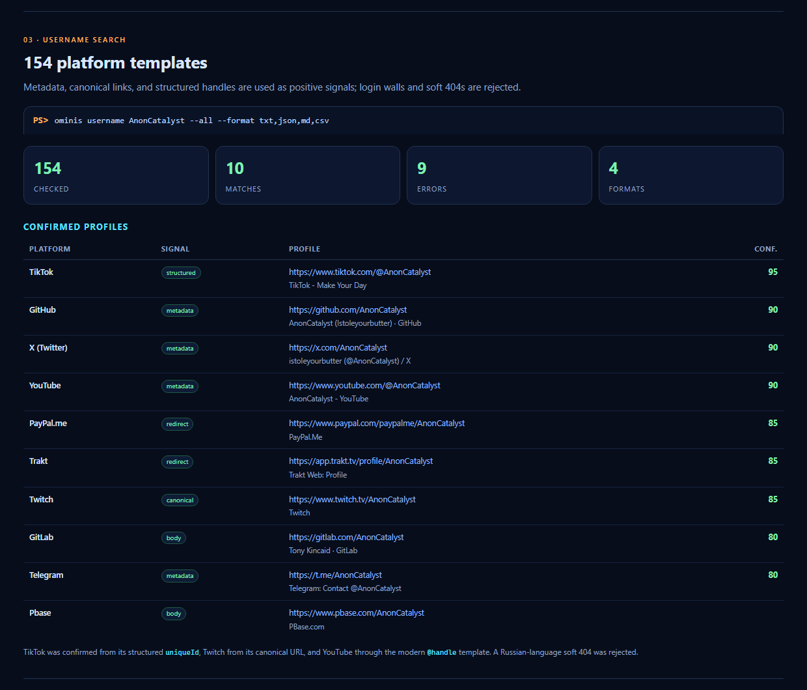
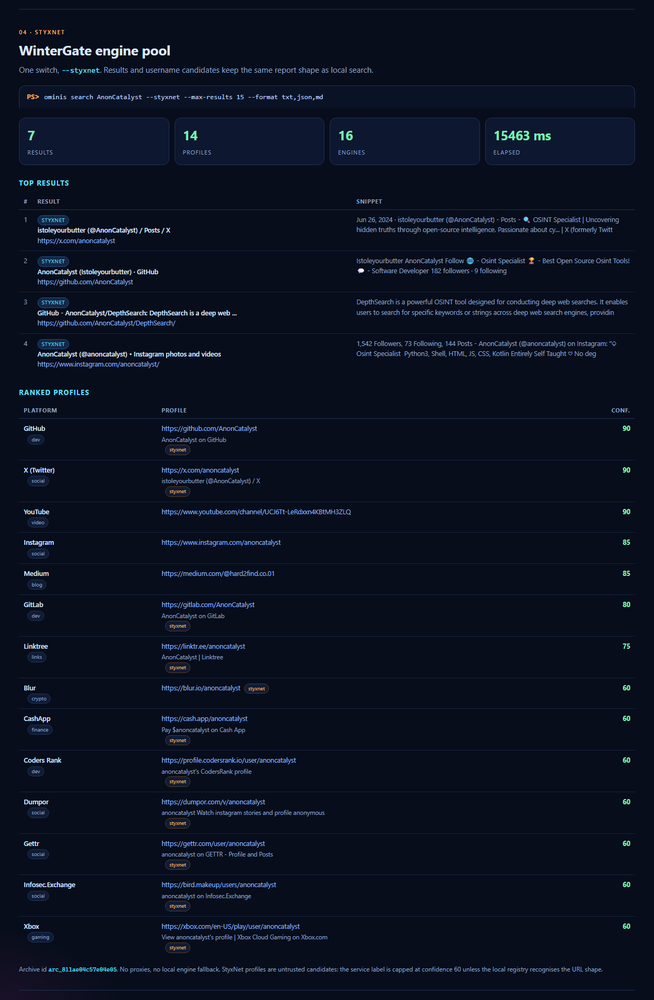
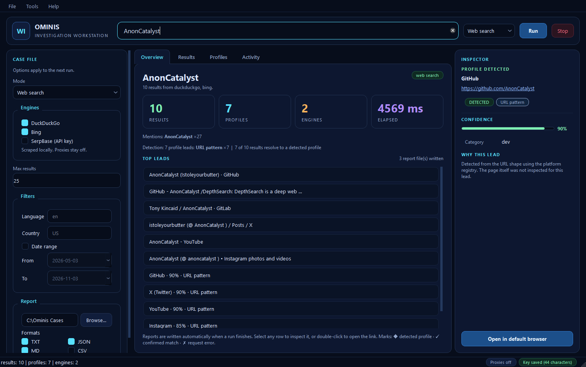
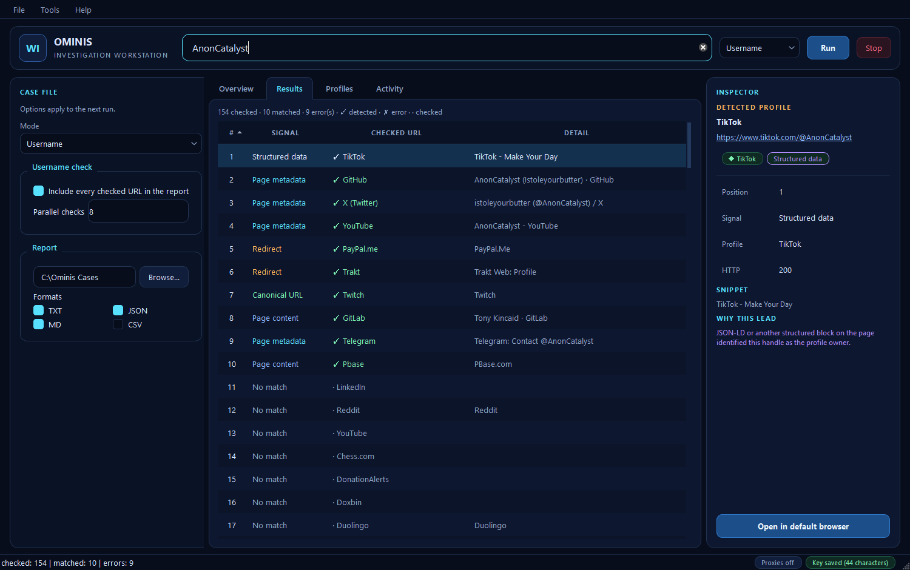

# Ominis-OSINT: Web Hunter 

[](https://pypi.org/project/ominis-osint-suite/)
[](https://github.com/AnonCatalyst/Ominis-OSINT/actions/workflows/tests.yml)
[](LICENSE)

Discover online mentions of a query or username, and map the social profiles
and forums that surface with them. Ominis searches public web results, reports
what it finds, and gets out of the way.

MIT licensed. Maintained by [AnonCatalyst](https://github.com/AnonCatalyst) with
the [WinterGate Intelligence Collective](https://wintergate.org).

> **Use it on your own presence or with permission.** Ominis only reads public
> pages, but a search can still be intrusive. You are responsible for the law,
> the site's terms, and the people whose data you touch.

# 🔗 **Official WIC Support Server**

• **Need Help?** Get assistance with our tools and services.
• **Want Access?** Request your StyxNet token here.
• **Stay Updated:** Track our latest releases and operations.

**Join now**: __https://discord.gg/tu5CynxjZq__


## Version 1.2.4

A small polish release for Windows command-line output.

- **No more phantom socket traceback.** When a checked site reset a pooled
  connection while the username checker closed it, Windows' asyncio proactor
  printed `ERROR: Exception in callback ... _call_connection_lost` even though
  the site was already recorded as an error and the run succeeded. That one
  callback is now ignored; real loop errors, including other connection
  failures, still surface.

## Version 1.2.3

A maintenance release for the desktop path and username checks. Highlights:

- **Proxy runs work in the windowed workstation again.** The legacy
  "enable proxy rotation display?" prompt tried to read standard input, which
  a windowed build does not have. Explicit proxy runs failed with
  `lost sys.stdin` before touching the network. Non-interactive callers now
  keep the display off and use the proxy; a terminal user can still opt in.
- **Leading `@` is accepted.** `ominis username @AnonCatalyst` and the
  workstation username mode now treat the at-sign as notation and check
  `AnonCatalyst`. Unsafe names are still rejected.
- **Build metadata is consistent.** The workstation executable reports
  `1.0.3.0` in both the fixed and string version fields.

## Version 1.2.2

This is the full suite. It is published alongside the patched original
(`v0.5.0`) so anyone relying on the old layout can keep it. 1.2.2 adds page
inspection, explicit proxy controls, and raw-only output, and fixes searches
that silently returned nothing when a dead proxy variable was set. Highlights:

- **Result pages are read, not just snippets.** The default scan pass fetches
  the top results and records what each page itself proves: metadata,
  canonical URL, structured handle fields, redirect target, and visible text.
  Reports carry the HTTP status, final URL, signal, and detail per row, and
  profiles inherit that evidence. Turn it off with `--no-scan-pages`, and cap
  it with `--scan-limit`.
- **Environment proxies are opt-in.** `HTTP_PROXY`, `HTTPS_PROXY`, and
  `ALL_PROXY` are ignored unless `--use-env-proxy` is passed. A stale dead
  proxy can no longer empty every engine. Explicit `--proxy`/`--proxy-file`
  pools still work, and a failed proxy still fails instead of falling back.
- **Raw output is allowed.** `--format none` prints results and writes no
  report files. The workstation has a matching "Save report files" switch.
- **Optional StyxNet search.** `--styxnet` sends the query to WinterGate's
  engine pool instead of scraping; local DuckDuckGo/Bing remain the fallback.
- **Cleaner results.** Canonical URLs collapse duplicate engine hits, engines
  are paged in lockstep, search plumbing is filtered out, and mentions are
  counted as whole words (including multi-word queries).
- **Better profile checks.** Username checks also read Open Graph metadata,
  canonical links, and structured handle fields, so valid TikTok, Twitch, and
  YouTube profiles are found without trusting a footer mention or a soft 404.
- **Deep detection.** A curated platform registry runs first, then the original
  wide `social_platforms.json` table (still shipped), then generic
  Discourse/Fediverse/forum rules. False positives from substrings, reserved
  words, and canonical links are rejected.
- **Real filters.** Language, country, and date ranges are passed to each
  engine instead of being accepted and ignored.
- **Optional results API.** Set `SERPBASE_API_KEY` and the Google leg goes
  through a SerpBase-compatible JSON API; leave it unset and the scrapers run
  as before.
- **No browser download.** Username checks share one HTTPX client instead of
  starting a `requests_html` Chromium session per URL.
- **Reports in four formats.** `txt`, `json`, `csv`, and `md`, with file names
  that are safe for any query. Or no files at all.
- **A real CLI.** Scriptable subcommands, exit codes, and a `doctor` check.

### See it run

Every image below comes from a real run on Windows, generated from the JSON
reports in [`docs/captures`](docs/captures). There is no mocked data.

| | |
|---|---|
| [](https://github.com/AnonCatalyst/Ominis-OSINT/blob/main/docs/screenshots/01-doctor.png) | [](https://github.com/AnonCatalyst/Ominis-OSINT/blob/main/docs/screenshots/02-local-search.png) |
| [](https://github.com/AnonCatalyst/Ominis-OSINT/blob/main/docs/screenshots/03-username-search.png) | [](https://github.com/AnonCatalyst/Ominis-OSINT/blob/main/docs/screenshots/04-styxnet.png) |

Full gallery: [`docs/screenshots/index.html`](docs/screenshots/index.html).
How each capture was produced: [`docs/captures/README.md`](docs/captures/README.md).

## Ominis Investigation Workstation (Windows)

A separate desktop product for Windows: a native **Qt window application**, not
a browser page and not an embedded web view. It wraps the same engine in one
desk for web search, username checks, and StyxNet, and it labels every profile
with the signal that detected it.

- Latest workstation: **1.0.4** (bundled engine **1.2.4**)
- Installer: [`Ominis-Workstation-1.0.4-win64-setup.exe`](https://github.com/AnonCatalyst/Ominis-OSINT/releases/tag/workstation-v1.0.4)
- Portable: [`Ominis-Workstation-1.0.4-win64.zip`](https://github.com/AnonCatalyst/Ominis-OSINT/releases/tag/workstation-v1.0.4)
- Guide and detection-signal table: [`docs/workstation/README.md`](docs/workstation/README.md)

| | |
|---|---|
| [](https://github.com/AnonCatalyst/Ominis-OSINT/blob/main/docs/workstation/screenshots/01-overview.png) | [](https://github.com/AnonCatalyst/Ominis-OSINT/blob/main/docs/workstation/screenshots/06-username-checks.png) |

The workstation build is unsigned and no signing is claimed. It is a separate
release from the command line suite; installing one does not install the other.

## Install

```sh
git clone https://github.com/AnonCatalyst/Ominis-OSINT
cd Ominis-OSINT
python -m pip install -r requirements.txt
```

Install the released package from PyPI:

```sh
python -m pip install ominis-osint-suite
```

The old `Ominis-OSINT` name on PyPI is still the 2024 `0.4.8` build and is no
longer updated. Prefer `ominis-osint-suite`, the checkout above, or a release
archive.

Python 3.10 or newer is required.

## Use

### Search

```sh
python ominis.py search "acme corp" --country US --lang en --max-results 40
```

Results are written to `Results/` (override with `--out`). Choose formats with
`--format txt,json,csv,md`. Use `--format none` to print results in the
terminal and write no files.

By default Ominis reads the top 10 result pages and stores what each page
proves: HTTP status, final URL, signal (metadata, canonical, structured,
redirect, body, or url), and a plain-language detail. Adjust the pass with
`--scan-limit N` or turn it off with `--no-scan-pages`.

Filters:

```sh
python ominis.py search "acme corp" --since 2025-01-01 --until 2025-12-31
```

Engines are `duckduckgo`, `bing`, and `serpbase`. The first two are scraped.
`serpbase` needs a key:

```sh
export SERPBASE_API_KEY=...            # PowerShell: $env:SERPBASE_API_KEY="..."
python ominis.py search "acme corp" --engine duckduckgo,serpbase
```

With a key, the Google leg is a JSON API call. Without one, the engine is
skipped with a clear message and the scraped engines still run. The API is
`POST https://api.serpbase.dev/google/search` with the key in `X-API-Key` and a
JSON body of `q`, `page`, `gl`, `hl`. Override the endpoint in
`ominis_src/config.py` if you use a compatible provider. Date filters are folded
into the query for this provider (`after:YYYY/MM/DD before:YYYY/MM/DD`), so the
other engines keep their native date parameters.

### StyxNet search (optional)

`--styxnet` is the only StyxNet feature switch (pass `--no-styxnet` to override
`OMINIS_STYXNET`). It sends the query to WinterGate's StyxNet service, which
searches its own engine pool, and writes the same report shape. Nothing else in
Ominis contacts StyxNet.

```sh
python ominis.py search "acme corp" --styxnet --max-results 20
```

Access is free during the preview but needs a key. **Join the WinterGate
Discord at <https://discord.gg/tu5CynxjZq> and request StyxNet access** from
AnonCatalyst there; keys are issued by hand. Access is free for now and will
stay free for a while as the user base grows.

Resolve a key in this order:

1. `--styxnet-key KEY`
2. `STYXNET_ACCESS_KEY` in the environment
3. `OMINIS_STYXNET_KEY` in the environment
4. `~/.config/ominis/styxnet-key.txt`
   (`%USERPROFILE%\.config\ominis\styxnet-key.txt` on Windows)
5. `%APPDATA%\ominis\styxnet-key.txt` when the first file is absent

Request a key at <https://discord.gg/tu5CynxjZq>. The service is described at
<https://wintergate.org/styxnet/>. The key is never printed or written to a
report; environment and file loading both mask it in output.

`--styxnet-engines N` (default 35, maximum 200) caps one request, and
`--styxnet-scopes` takes a comma-separated subset of `surface`, `onion`, and
`deep` (default all three).

StyxNet is shared, so the client enforces courtesy limits for every terminal
on the machine: one search at a time, at least 10 seconds apart, 20 per rolling
hour, and 100 per rolling day. The counters live under `~/.config/ominis/`
and cannot be raised from the CLI. If StyxNet is rate limited, rejects the key,
or errors, Ominis prints the reason and falls back to the local engines rather
than returning nothing.

### Username search

```sh
python ominis.py username acme --format txt,json,md
```

The platform list lives in `ominis_src/urls.txt`, one URL template per line.
`--urls FILE` points at your own list. Checks run concurrently (default 8),
each with its own timeout. `--all` prints and records non-matches too. Every
match is labelled with a platform and category where the registry knows it,
and with a readable host label otherwise.

### Platform detection

Search reports classify result URLs in this order:

1. A curated registry of common profile shapes (GitHub, X, Reddit, Mastodon,
   forums, and so on), with category and confidence.
2. The original wide table in `ominis_src/social_platforms.json`, matched on
   an anchored host and the full path, so `github.com/features` is not a
   profile.
3. Generic Discourse, Fediverse, and forum rules.

Reserved words (`about`, `login`, `search`, `features`, `settings`, …),
substring matches, and links that only appear in a canonical tag do not count
as profiles. Both original data files, `social_platforms.json` and `urls.txt`,
remain part of the package.

### Proxies (opt-in)

```sh
python ominis.py proxy harvest --limit 50
python ominis.py search "acme corp" --proxy-file config/valid_proxies.txt
```

`proxy harvest` downloads candidates, validates them, and writes the working
pool. Nothing else in Ominis calls it. You can also pass endpoints directly:

```sh
python ominis.py search "acme corp" --proxy 127.0.0.1:8080 --proxy socks5://127.0.0.1:1080
```

Bare `host:port` entries are HTTP proxies. `http://`, `https://`, `socks5://`,
and `socks5h://` URLs are accepted, including authenticated forms. Credentials
are redacted from console output and error logs. An explicit pool is never
silently bypassed: if every proxy fails, the request fails.

Environment proxies are different: Ominis ignores `HTTP_PROXY`, `HTTPS_PROXY`,
and `ALL_PROXY` unless you pass `--use-env-proxy`. This is deliberate. A dead
proxy variable inherited from another tool used to make every search return
zero results with no clear error. The workstation has the same two controls,
and its environment check tests the direct route.

TLS verification is on. For a private CA set `SSL_CERT_FILE` (honoured
explicitly even though proxy environment variables are ignored).
`--no-verify` exists for debugging and is not recommended.

### Guided mode

`python ominis.py` with no arguments walks through a search and offers a
username check at the end. Every prompt has a default; proxies default to off.

### Health check

```sh
python ominis.py doctor
```

## Try it from GitHub Actions

The **Ominis demo** workflow runs a search or username check on GitHub's
runners and uploads the report as an artifact. No clone, no install:

1. Open **Actions → Ominis demo → Run workflow**.
2. Pick `search`, `username`, or `both`, and fill in the query.
3. Download `ominis-results` when it finishes.

It uses `contents: read`, passes inputs through environment variables rather
than interpolating them into shell code, and does not use sudo or Tor.

## Configuration

| Variable | Meaning | Default |
| --- | --- | --- |
| `OMINIS_ENGINES` | comma-separated engine list | `duckduckgo,bing` |
| `OMINIS_LANGUAGE` | language code, e.g. `en` | none |
| `OMINIS_COUNTRY` | country code, e.g. `US` | none |
| `OMINIS_SINCE`, `OMINIS_UNTIL` | `YYYY-MM-DD` bounds | none |
| `OMINIS_MAX_RESULTS` | total results to keep | `50` |
| `OMINIS_PROXY_POOL` | comma-separated proxy endpoints | off |
| `SERPBASE_API_KEY` | optional results API key | none |
| `STYXNET_ACCESS_KEY` | StyxNet key; only used with `--styxnet` | none |
| `OMINIS_STYXNET` | set truthy to enable StyxNet | off |
| `OMINIS_STYXNET_KEY` | alternate StyxNet key variable | none |
| `OMINIS_STYXNET_ENDPOINT` | StyxNet API base URL | WinterGate |
| `OMINIS_STYXNET_ENGINES` | engines per StyxNet request | `35` |
| `OMINIS_STYXNET_SCOPES` | `surface,onion,deep` | all |
| `OMINIS_OUTPUT_DIR` | report directory | `Results` |
| `OMINIS_FORMATS` | `txt,json,csv,md` | `txt,json` |
| `OMINIS_TIMEOUT` | seconds per request | `15` |

Arguments win over environment variables. The tool never writes secrets to
disk.

## Output

| File | Contents |
| --- | --- |
| `Results/<query>.txt` | human-readable results and summary |
| `Results/<query>.json` | summary, results, profiles |
| `Results/<query>.csv` | one row per result |
| `Results/<query>.md` | Markdown brief |
| `Results/username-<name>.<ext>` | username matches and errors |

`<query>` is a slug: letters, digits, `.`, `-` and `_` only, at most 60
characters. `../../notes` becomes `notes`, so a query can never choose the
directory a report is written to.

## Development

```sh
python -m pip install -r requirements-test.txt
python -m pytest -q
```

The suite is offline. Transport tests run against loopback proxies and locally
generated certificates; engine and report tests parse fixed fixtures. CI runs
the same command on Python 3.10, 3.11, and 3.12. CodeQL runs through the
repository default setup, with dependency updates from
`.github/dependabot.yml`.

See [CONTRIBUTING.md](CONTRIBUTING.md) for setup, style, and pull-request
expectations, and [CODE_OF_CONDUCT.md](CODE_OF_CONDUCT.md) for community rules.

Layout:

```
ominis.py              entry point (delegates to ominis_src.cli)
ominis_src/
  cli.py               subcommands and arguments
  config.py            settings, environment, proxy files
  engines.py           DuckDuckGo, Bing, SerpBase, parsers
  search.py            orchestration, de-duplication, reports
  username.py          profile checks
  report.py            safe file names and writers
  proxy_handler.py     opt-in harvesting and validation
  wizard.py            guided first run
  tools_handler.py     legacy scraping API (kept for compatibility)
  utils.py             mentions, profiles, forums
tests/                 offline tests
```

## Security

- Reports are plain text; do not paste them into public issues if they contain
  personal data.
- Proxy endpoints are untrusted input. The parser rejects malformed entries and
  never logs credentials.
- Please report vulnerabilities privately: see [SECURITY.md](SECURITY.md) or use
  the repository's Security tab. Never open a public issue with a live key.
- No API key, token or proxy credential is written to disk by the tool.

## Licence

MIT. See [LICENSE](LICENSE). This release is not code-signed; see
[CODE_SIGNING.md](CODE_SIGNING.md) for the SHA-256 verification steps and why
there is no self-signed certificate. The WinterGate names and logos are covered
by [TRADEMARKS.md](TRADEMARKS.md), not by the MIT licence.
