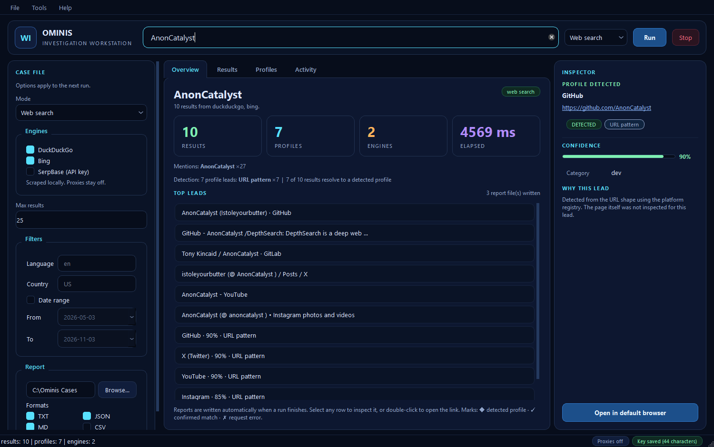
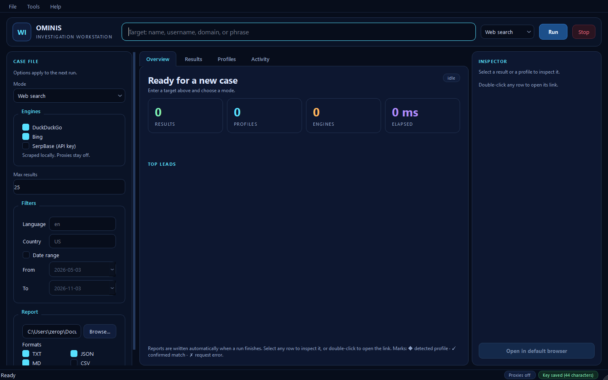
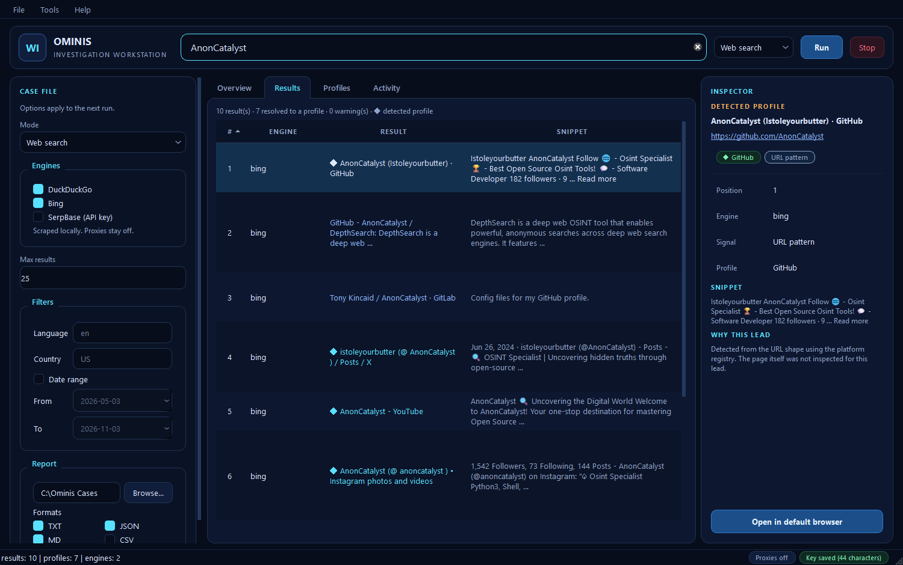
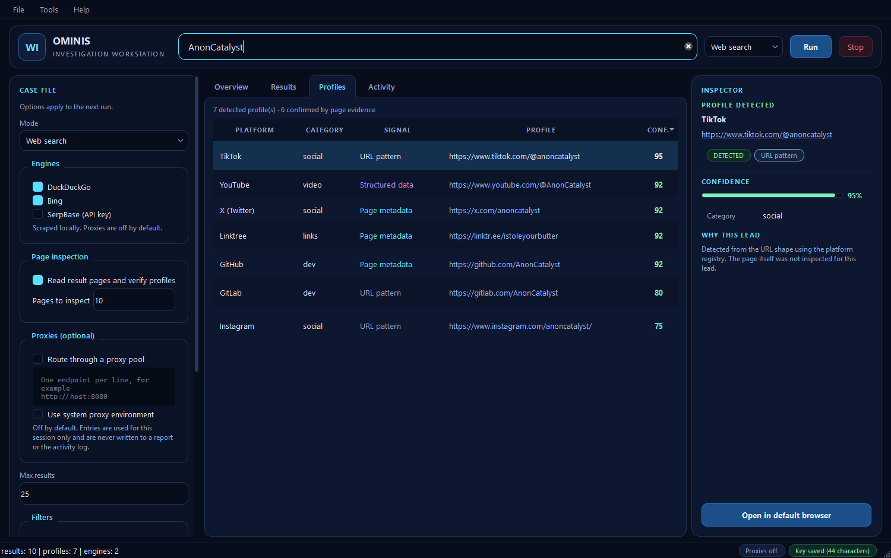
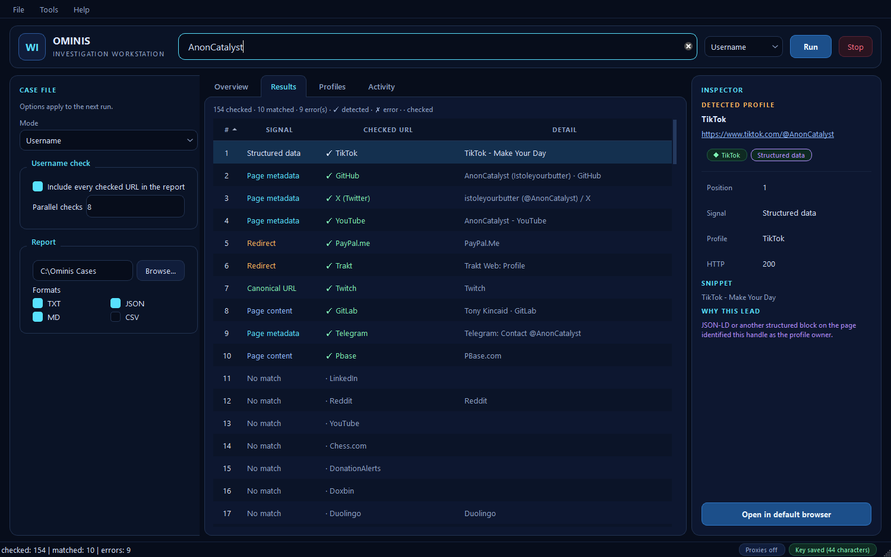
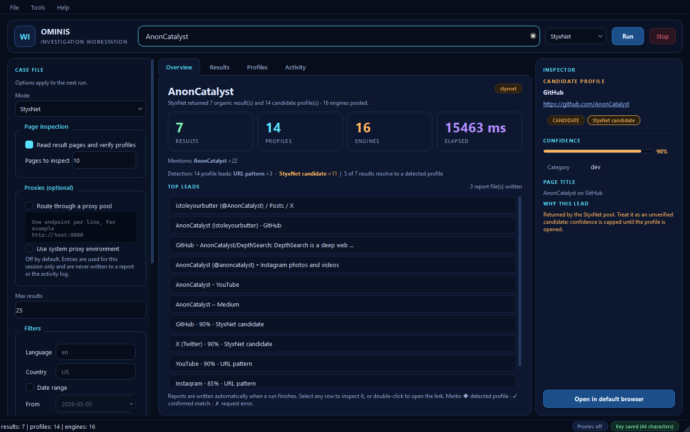
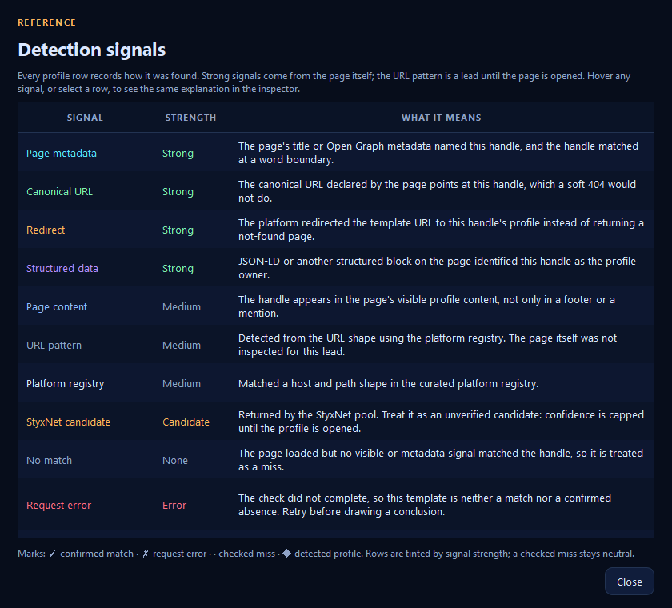

# Ominis Investigation Workstation

A native Windows desktop application for the Ominis engine. It is a real Qt
window built with PySide6 — **not a browser page, not a local web server, and
not an Electron shell**. There is no embedded browser: search results, profile
checks, StyxNet runs, and reports all happen inside one desktop window.

- Workstation version: **1.0.4**
- Bundled engine: **Ominis 1.2.4**
- Platform: Windows 10/11, 64-bit
- License: MIT



## Download and install

Download `Ominis-Workstation-1.0.4-win64-setup.exe` and run it. The installer is
per-user by default, so it does not need administrator rights. It adds a
**Desktop** shortcut, a **Start menu** entry, and an entry under **Settings >
Apps** so the app can be uninstalled normally.

A portable `Ominis-Workstation-1.0.4-win64.zip` is also published. Unpack it and
run `OminisWorkstation.exe` if you do not want an installed copy.

If you use the portable build, or move the folder after installing, run
**Tools > Install desktop shortcut...** (also in Settings) to recreate the
Desktop and Start menu shortcuts against the current executable.

The installed app keeps window preferences in the registry and writes reports
only where you ask. The optional StyxNet key file stays in your user profile.
Uninstalling removes the program and its shortcuts; it leaves case reports,
saved preferences, and the StyxNet key file alone.

The build is **unsigned**. Windows SmartScreen may show a warning for an
unknown publisher. No code signing is claimed; see `CODE_SIGNING.md` in the
repository for why.

SHA-256 digests for every release asset are published with the release.

## Three modes

| Mode | What it does |
|---|---|
| **Web search** | Scrapes DuckDuckGo and Bing locally, or calls SerpBase when a key is set. Results are canonicalised, and profiles are detected from URLs plus the page evidence collected by the inspection pass. |
| **Username** | Checks a handle against the shipped platform templates over HTTPS and confirms a profile from page metadata, canonical links, redirects, structured data, or visible page content. |
| **StyxNet** | Sends one request to WinterGate's engine pool. Organic results and candidate profiles come back together. Candidate confidence is capped until you open the profile. |

StyxNet replaces the local engines for that run and falls back to them if the
service errors. It is optional and never enabled by default.

### Access to StyxNet

Access is free right now and will stay free for the foreseeable future. Join
the WinterGate Discord and ask for a key:

<https://discord.gg/tu5CynxjZq>

The key is stored in `~/.config/ominis/styxnet-key.txt` (or
`%USERPROFILE%\.config\ominis\styxnet-key.txt`) with the file permissions
tightened to the current account. An existing key in
`%APPDATA%\ominis\styxnet-key.txt` is also accepted. Settings never display the
key again; it shows only whether a key is saved and how many characters it has.
You can also use `STYXNET_ACCESS_KEY` or `OMINIS_STYXNET_KEY` if you prefer
environment variables. Client-side limits (one search at a time, 20 per hour,
100 per day, 10 seconds between searches, 200 engines per request) are enforced
by the engine, not by the window, so they hold across terminals too.

## Detection signals

Every profile row says **how** it was detected. The same vocabulary is used in
the results table, the profile table, and the inspector.

| Signal | Meaning | Strength |
|---|---|---|
| **Page metadata** | The page title or Open Graph metadata named the handle at a word boundary. | Strong |
| **Canonical URL** | The page's canonical URL points at the handle, which a soft 404 would not do. | Strong |
| **Redirect** | The template URL redirected to the handle's profile instead of a not-found page. | Strong |
| **Structured data** | JSON-LD or another structured block named the handle. | Strong |
| **Page content** | The handle appears in visible profile content, not a footer mention. | Medium |
| **URL pattern** | The URL shape matched the curated platform registry. The page was not inspected. | Medium |
| **StyxNet candidate** | Returned by StyxNet. Unverified until you open it. | Candidate |
| **No match** | The page loaded but nothing matched the handle. | None |
| **Request error** | The check did not complete. Neither a match nor a confirmed absence. | Error |

The interface carries the same information visually:

- a **Signal** column with a colour per detection type;
- a tinted confidence cell and a numeric confidence, with `—` when the host has
  no registry confidence;
- a **◆** mark on search results that resolve to a detected profile;
- **✓** for found username checks, **✗** for errors, **·** for checked misses;
- an inspector with a confidence meter, the signal in plain language, and a
  reminder that StyXNet results are leads, not proof;
- **Help → Detection signals** (or F1) for the full reference, with the same
  explanation used in the tooltips and the inspector.

Rows are tinted by the strength of the evidence. A checked miss stays neutral,
so confirmed rows stand out. Links open in your default system browser; the
workstation never embeds a web view.

Confidence is not a probability. It reflects the strength of the signal and
the registry entry for that host. Treat anything below 70 as a lead to verify.

## Screenshots

All images are rendered by Qt itself from captured runs. The payloads in
[`captures/`](captures) come from real JSON reports in
[`../captures`](../captures); nothing here is mocked or drawn in a browser.

| | |
|---|---|
|  |  |
|  |  |
|  |  |

More: [username profiles](screenshots/05-username-profiles.png),
[StyxNet profiles](screenshots/08-styxnet-profiles.png),
[settings](screenshots/09-settings.png), [about](screenshots/10-about.png),
[environment check](screenshots/11-doctor.png).

> StyxNet's organic result lane returned no rows on 2026-11-03 while candidate
> profiles still came back. The StyxNet screenshots therefore replay the
> verified 2026-11-02 capture and are labelled from that run. The live
> behaviour is recorded in [`../captures`](../captures).

## Page inspection

Web searches fetch the top result pages by default and record what each page
itself proves. The case panel controls the pass:

- **Read result pages and verify profiles** turns the pass on or off.
- **Pages to inspect** caps how many of the top results are fetched.

The results table gains a **Signal** column once pages have been read, and the
inspector shows the HTTP status, final URL after redirects, page title, and a
plain-language detail. A profile returned only by a URL shape is kept as a lead
but its confidence is capped until page evidence confirms it. Pages that block
the client are reported as errors, not matches.

## Reports

Every finished run writes the formats selected in the case panel (`txt`,
`json`, `md`, and optionally `csv`) to the chosen folder. The default is
`Documents\Ominis Cases`. **Open report folder** opens the last run's folder.
Clear **Save report files** to keep results in the window only: no folder is
created and no files are written.

Reports are plain files. Nothing is uploaded anywhere. The StyxNet key is never
written into a report. Scanned rows include the HTTP status, final URL, signal,
detail, and page title/description fields.

## Proxies

Proxies are optional and off by default. The workstation never downloads,
validates, or scrapes a proxy list on its own. The case panel has two separate
controls:

- **Route through a proxy pool** enables the endpoint box. One endpoint per
  line; bare `host:port` is treated as HTTP, and `http://`, `https://`,
  `socks5://`, and `socks5h://` are accepted. Entries stay in memory for the
  session and are not written to a report or the activity log.
- **Use system proxy environment** honours `HTTP_PROXY`, `HTTPS_PROXY`, and
  `ALL_PROXY`, but only while the pool control is enabled. Without it, those
  variables are ignored, so a stale value cannot silently empty a run.

An explicit pool is never bypassed. If every endpoint fails, the request fails
and the activity log says so. **Environment check** tests the direct route and
shows whether proxy variables are set without printing their values (they can
contain credentials).

## Run from source

Python 3.10 or newer:

```sh
python -m pip install -r requirements.txt
python -m pip install PySide6
python ominis_workstation.py
```

or:

```sh
python -m ominis_workstation
```

Verify a build without touching the network:

```sh
python -m ominis_workstation --smoke build-smoke.txt
```

The smoke report checks the window, icon, stylesheet, tabs, and imports, and
exits non-zero if the window itself did not come up. Add a `.png` path to save
a render of the window instead.

## Build the executable

On Windows, in the repository root:

```sh
python -m pip install PyInstaller
pyinstaller --noconfirm --clean workstation.spec
```

The result is `dist\OminisWorkstation.exe`, with the Qt runtime, the Ominis
engine, and both detection tables inside. The spec excludes Qt WebEngine on
purpose: there is no browser in this application.

## Build the installer

Install [Inno Setup 6](https://jrsoftware.org/isinfo.php), then compile
`workstation.iss` from the repository root after PyInstaller:

```sh
ISCC.exe workstation.iss
```

The result is `dist\Ominis-Workstation-1.0.4-win64-setup.exe`. The installer is
per-user, so testing it does not require an administrator shell. It contains
the same executable as the portable zip plus `README.md`, `LICENSE`,
`TRADEMARKS.md`, and `CODE_SIGNING.md`.

## Tests

The headless Qt tests cover payload mapping, detection labels, default sort
order, the inspector, mode synchronisation, and key handling:

```sh
python -m pytest tests/test_workstation.py -q
```

The full suite covers the command line engine:

```sh
python -m pytest -q
```

## Identity and licence

MIT licensed. Maintained by [AnonCatalyst](https://github.com/AnonCatalyst) with
the [WinterGate Intelligence Collective](https://wintergate.org). The
collective is independent and unincorporated. This project is not affiliated
with any platform it checks.

Use it on your own presence or with permission. Ominis only reads public pages,
but a search can still be intrusive. You are responsible for the law, the
site's terms, and the people whose data you touch.
